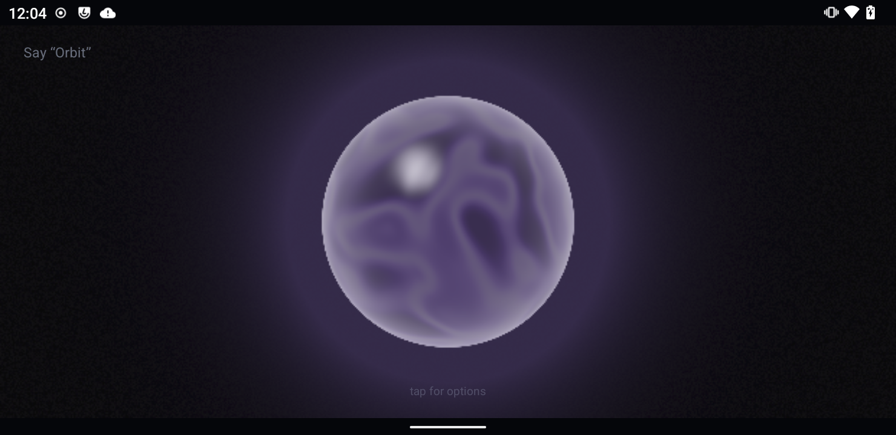
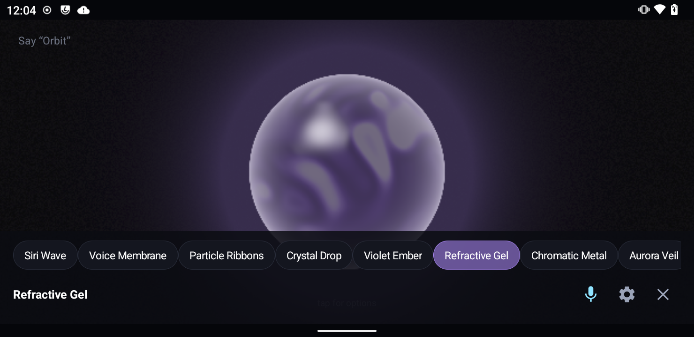

# Orb Hermes

A voice front-end for a **local** Hermes agent: a liquid-glass orb that sits on
your desk, wakes to your voice, and answers with your own agent — the one with
your memory, your notes and the ability to search the web.



- **App** (Android, Kotlin): 13 orb presets, wake word, speech in, speech out.
  Keeps listening with the screen off.
- **Bridge** (Python): runs on your server. Transcribes your speech, talks to
  Hermes, turns the answer into speech.
- **Relay** (Python, Mac): optional. Lets the phone reach a firewalled server
  without opening a port.

Everything is local. No cloud account, no API key for the core path, no
internet connection required once it is installed.

---

## Table of contents

- [How it fits together](#how-it-fits-together)
- [What you need](#what-you-need)
- [Just want the APK?](#just-want-the-apk)
- [1. Install the bridge](#1-install-the-bridge)
- [2. Point the phone at it](#2-point-the-phone-at-it)
- [3. Use it](#3-use-it)
- [Building the app](#building-the-app)
- [Tests](#tests)
- [How the wake word is caught](#how-the-wake-word-is-caught)
- [Keeping it alive with the screen off](#keeping-it-alive-with-the-screen-off)
- [When the server is slow](#when-the-server-is-slow)
- [Troubleshooting](#troubleshooting)
- [Repository layout](#repository-layout)
- [Licence](#licence)

---

## How it fits together

```
   phone (J4+)                 your server                Hermes agent
 ┌──────────────┐   HTTP    ┌────────────────┐  CLI/API  ┌──────────────┐
 │  orb app     │ ────────► │  hermes_bridge │ ────────► │  your agent  │
 │  mic → wav   │   ◄────── │  /wake /stt    │  answer   │  tools, web, │
 │  wav → tts   │   audio   │  /chat /tts    │           │  memory      │
 └──────────────┘           └────────────────┘           └──────────────┘
```

The phone never talks to the agent directly. It talks to the **bridge**, a
small HTTP service that owns speech recognition, the agent call and speech
synthesis. That keeps the phone dumb, keeps the credentials on the server, and
means one shared token guards every request.



## What you need

| Piece | Why | Notes |
|---|---|---|
| An Android phone | The orb | Runs on Android 7+; tested on a Galaxy J4+ (Mali-T720, Android 12) |
| A Linux server | The bridge | Anything that runs Python 3 and your Hermes agent — a mini PC, a NAS, an old laptop |
| The Hermes agent | The brain | Installed and working on that server, with the tools and web search you want |
| A Mac *(optional)* | The relay | Only if the server refuses inbound connections |

The phone and the server need to be on the same network. Nothing else does.

---

## Just want the APK?

The [v1.0.0 release](https://github.com/krumjahn/orb-hermes/releases/tag/v1.0.0)
has a signed APK. Install it straight from your phone's browser:

1. Download `orb-hermes-v1.0.0.apk` from the release page.
2. Tap it and let your browser install unknown apps for this one download.
3. Open **Orb Hermes**.

No account, no sign-up, and **no server address baked into the APK**. The app
starts blank and waits for you to tell it where your bridge is:

- Tap the orb to reveal the options strip, then the **gear**.
- Set **Hermes server** to your bridge, for example `http://192.168.1.20:8787`.
- Paste the token the bridge printed when it started.

The token is the only secret, and it never leaves your phone. Everything else -
the server, the agent, your notes - stays on your own hardware.

You still need your own bridge and your own agent (see
[What you need](#what-you-need)). The APK is the phone half; the bridge is the
other half, and you run that yourself.

> The release APK is signed with a publisher key, so a later version installs
> over this one without an uninstall. If you ever put on a build signed with a
> different key, Android refuses to replace it and you have to uninstall first.

---

## 1. Install the bridge

Copy the `beelink/` folder to the server and run the installer:

```bash
scp -r beelink/ you@your-server:~/orb-setup
ssh you@your-server 'cd ~/orb-setup && bash beelink/install.sh'
```

`install.sh` generates a shared token, installs the dependencies, starts the
bridge as a service that survives reboots, and prints the token. Paste that
token into the phone.

Check it:

```bash
curl -s http://127.0.0.1:8787/health
# {"ok": true, "bridge": "2026-11-19f", "hermes": "cli", "model": "..."}
```

`/health` is deliberately unauthenticated — it is a liveness probe and reveals
nothing. Every other endpoint requires the token.

### Without SSH

If the only way onto the server is a terminal, paste this:

```bash
curl -fsSL http://your-mac:8899/BEELINK-BRIDGE-UPDATE.sh | bash
```

That script downloads the bridge from a plain HTTP file server on your Mac and
installs it. See [the relay notes](RELAY-FALLBACK.md) for the file server and
the firewall workaround in one place.

### Voice backends

All of these are detected at call time, so the bridge works with whatever you
have installed. If nothing is available for a step, the phone falls back to
its own Android speech engine.

| Function | First choice | Fallbacks |
|---|---|---|
| Wake word (`/wake`) | local faster-whisper / whisper | MiniMax (`mcode-tools`) |
| Speech → text (`/stt`) | MiniMax (`mcode-tools`) | local faster-whisper / whisper.cpp |
| Text → speech | MiniMax (`mmx`) | Edge TTS (free), Piper (local) |
| Chat | Hermes CLI (`hermes --model NAME chat --query "..."`) | the Hermes OpenAI-compatible API server, then Ollama |

The wake word always uses the local model first, because it has to answer fast
enough to feel instant; the full transcription can afford the slower path.

> **A note on the agent call.** The Hermes CLI is `hermes [options] <command>
> [args]` — the options have to come **before** the command. `hermes chat
> --query "..."` is rejected by the argument parser, and the agent then runs
> with no model at all and answers `model is required`. The bridge tries the
> options-first form first and keeps several other shapes as fallbacks.

---

## 2. Point the phone at it

Open the app, tap the orb to reveal the options strip, then the **gear**:

- **Hermes server**: `http://your-server:8787`
- **Access token**: the token the installer printed
- **Wake word**: `Orbit` by default
- **Orb render scale**: `0.25`–`1.0`, default `0.42`
- **Show text hints**: on = a faint "Say Orbit", off = the orb and nothing else

Tap **Save**, then **Test** to check the connection.

The bridge accepts a comma-separated list of tokens, so a second device can
keep working while you rotate the secret:

```bash
BRIDGE_TOKEN="old-secret,new-secret"
```

## 3. Use it

The phone lies on your desk in landscape. That is the whole interface.

**Standing by** — the orb dims over ~45 seconds of silence and brightens again
as soon as you interact with it. Say **"Orbit"** to wake it.

**Awake** — the orb lights up and listens. It captures audio continuously and
stops sending while it talks back, so it cannot hear itself.

**Speaking** — the orb grows and shrinks with the audio of the reply, so you
can see it talking from across the desk.

**After the reply** — it goes back to listening, so you can keep the
conversation going. After 25 seconds of silence it stands down and dims again.

Transcripts appear at the bottom while you talk and fade away on their own, so
the desk settles back to a bare orb.

---

## Building the app

You need JDK 17, the Android SDK (API 36) and Gradle 8.x. The build script
finds all three:

```bash
./build_and_install.sh                 # debug build + install over USB
RELEASE=1 ./build_and_install.sh       # release build
```

Or with Gradle directly:

```bash
gradle assembleRelease
# -> app/build/outputs/apk/release/app-release.apk
```

Without a `keystore.properties` the release build falls back to the Android
debug key, which is fine for an APK you only put on your own phone. For an APK
you hand to other people, sign it with your own key: copy
`keystore.properties.example` to `keystore.properties` in the project root and
fill it in. The key you sign with is the key everybody has to keep, because
Android refuses to install a new APK over an old one signed with a different
key.

> **The application id is `com.keith.orbhermes`.** It is left as it is on
> purpose: the app is already installed under that id and renaming it would
> break the install. Change `applicationId` in `app/build.gradle.kts` and the
> `package` lines in the Kotlin sources if you want your own.

---

## Tests

Everything can be checked offline, without a phone and without the agent:

```bash
./tools/test-app-logic.sh               # the app's pure-Kotlin logic
python3 tools/test-bridge-backend.py    # the bridge's model + agent discovery
python3 tools/test-bridge-http.py       # the bridge's HTTP surface
python3 tools/test-bridge-wake.py       # the bridge's wake matcher
python3 tools/test-relay.py             # the relay
bash tools/test-installer-sandbox.sh    # the installer, against a fake server
bash tools/test-bridge-version-sync.sh  # the bridge and the scripts agree
```

The bridge and the phone run the **same** wake-word matching rules, and the
tests check both copies, so they cannot drift apart.

---

## How the wake word is caught

The recorder cuts the microphone into clips, and the clip has to **start at the
onset of the speech**. A transcriber handed a clip that begins in the middle of
"Orbit" hears "bit" instead, and the wake word is missed — measured on real
speech, a clip that starts 50 ms late is already enough to lose it.

So the energy VAD runs on 25 ms frames, the exact offset of the onset is
remembered, and the first clip of an utterance is built as 0.15 s of lead-in
audio plus 1.2 s of speech counted from that onset. Clips that continue the same
utterance start exactly where the previous one ended, so no audio is lost.

Two more things matter for the wake word to feel instant:

- The Whisper model stays **resident** in the bridge instead of being reloaded
  for every clip. That was the difference between `/wake` answering in ~8
  seconds (the orb then missed the wake word) and ~0.6 seconds.
- **The bridge reads the wav itself and never calls PyAV.** faster-whisper
  hands a file path to PyAV, and PyAV 15+ dropped the `metadata_errors`
  argument that faster-whisper still passes. The phone only ever sends plain
  16 kHz PCM WAV, so the bridge reads the samples itself (`load_audio`) and
  hands faster-whisper a numpy array. No PyAV pin is needed, and any version
  works.

### The whole utterance, once

The wake clip, the question and everything between them are kept as **one**
piece of audio and transcribed in a **single** request.

This matters more than it sounds. Stitching words together from per-clip
transcripts cuts mid-word, because the byte offsets land inside the word:

```
clip 1  -> "how are the Toronto rap?"
clip 2  -> "how are the Toronto- Raptors Raptors"
```

The answer was right, but the question was mangled, and the agent was asked
the wrong thing. Keeping the utterance as audio and transcribing it once fixes
it: the same recording now transcribes to *"how are the Toronto Raptors doing
this season?"*.

`Utterance.kt` holds the audio, `OrbCore.finishUtterance` uses the
whole-utterance text, and the per-clip text is only a fallback.

---

## Keeping it alive with the screen off

Android takes the microphone back the moment the activity leaves the
foreground, so the voice pipeline cannot live in the activity. It lives in
`OrbCore`, a process-wide singleton, and `OrbService` is a **microphone
foreground service** that keeps the process alive and holds the "while in use"
privilege.

The practical effect: you can turn the screen off and the orb still hears
"Orbit", still answers, and still breathes while it speaks. There is a quiet
notification (`Orb is listening`) that cannot be dismissed.

```bash
adb shell dumpsys activity services com.keith.orbhermes | grep isForeground
#   isForeground=true foregroundId=4711
```

## When the server is slow

Speech is sent to the bridge in short chunks. If the bridge cannot keep up,
the phone keeps the captured audio anyway and re-reads the whole utterance in
one piece once you stop talking, so a slow machine loses clarity rather than
words. Watch for it in logcat:

```bash
adb logcat -s OrbHermes:* | grep -E "chunk dropped|recovered utterance"
```

The agent itself can take a while — a cold 27B model needs about a minute to
load, and a tool-using answer can run for a minute and a half. The phone waits
420 s for an answer, and the bridge keeps its own model warm.

## Troubleshooting

**"Not reachable" in the corner** — the orb checks the bridge every 30 seconds.
If the bridge is down it says so once and then goes back to being a quiet orb.
When the bridge comes back, it notices by itself. You do not need to restart
the app after restarting Hermes.

**The wake word never fires** — check the microphone level in logcat:

```bash
adb logcat -s OrbHermes:* | grep "mic level"
# mic level=0.1103 thr=0.0289 floor=0.0090 clips=1 muted=false
```

A level around `0.002` means the phone hears only the room; `0.01` and up
means the phrase is arriving.

**The wake word fires but the question is wrong** — that is the cut-off
problem above. Make sure the phone is running a build with the whole-utterance
fix, and check the relay log for the text it actually sent.

**Only the built-in speakers work for testing** — a Bluetooth headset that
reconnects steals the default output, and its codec mangles the consonants of
"Orbit" into something the transcriber never recovers.
`tools/test-wake-acoustic.sh` says the phrase out loud and watches the phone
react; it switches the output first.

---

## Repository layout

```
app/                    the Android app
  src/main/java/com/keith/orbhermes/
    OrbCore.kt            the voice pipeline
    OrbService.kt         the microphone foreground service
    MainActivity.kt       the screen
    OrbShader.kt          the liquid-glass shader (OpenGL ES 3.0)
    Utterance.kt          keeps an utterance as audio, transcribes it once
    WakeWord.kt           the forgiving wake-word matcher
beelink/                the server side
  hermes_bridge.py        the HTTP bridge
  relay_mac.py            the Mac-side relay
  relay_dialer.py         the dialer that calls out from the server
  setup-beelink.sh        the installer
  install.sh              the one-command installer
  selftest-stt.py         proves the speech path works
tools/                  the tests and the helper scripts
docs/
  ORB-HERMES-STORY.md     how this was built, and the bugs behind it
  images/
```

`docs/ORB-HERMES-STORY.md` is the long version: what actually happened, with
the evidence, including the bug that kept the orb from ever talking to the
agent.

## Licence

MIT — see [LICENSE](LICENSE), and [NOTICE](NOTICE) for the attribution of the
orb's look.

The liquid-glass orb's look comes from
[LerSent001/orb](https://github.com/LerSent001/orb) (also MIT). The preset
names and palette are theirs; the renderer here is a native OpenGL ES 3.0
rewrite, because the reference project is WebGPU and the phone is not.
